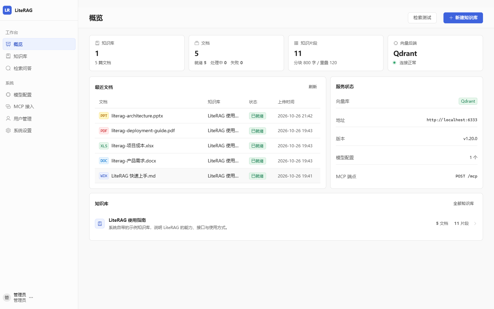
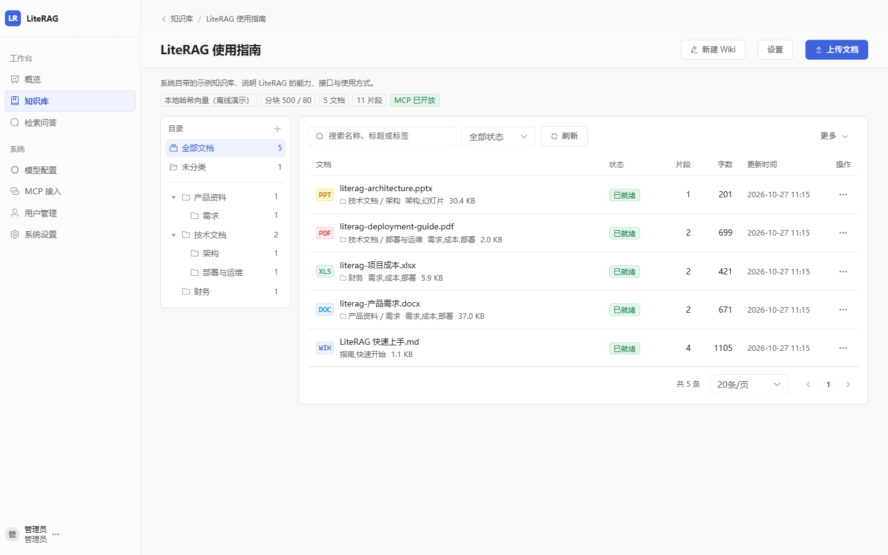
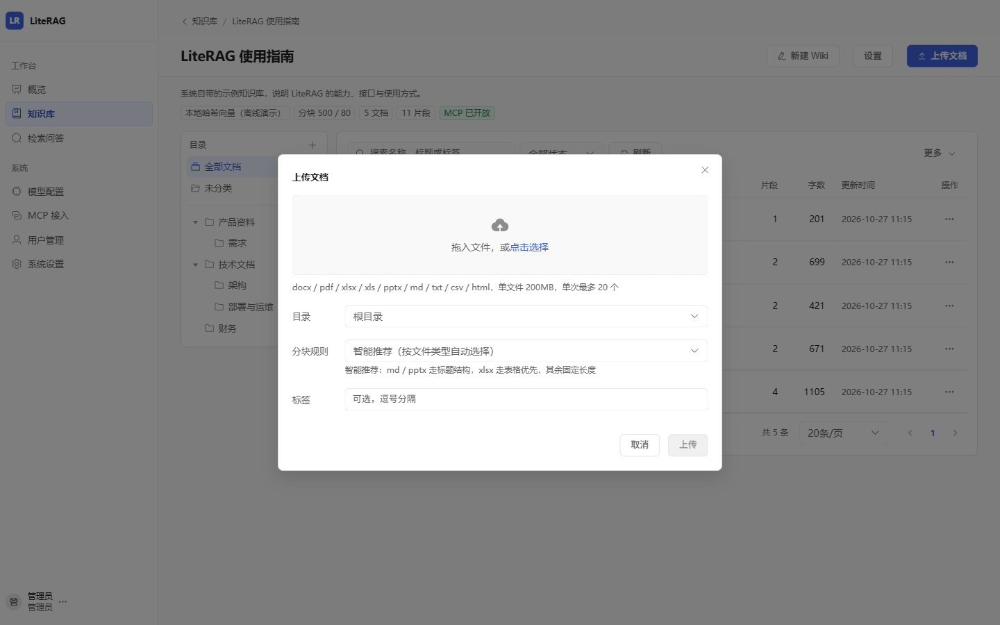
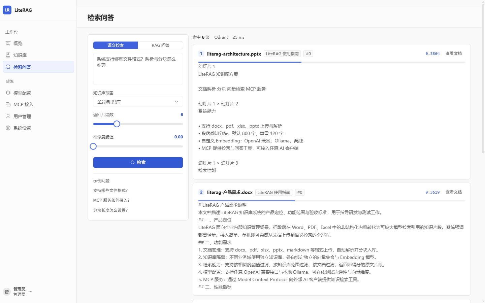
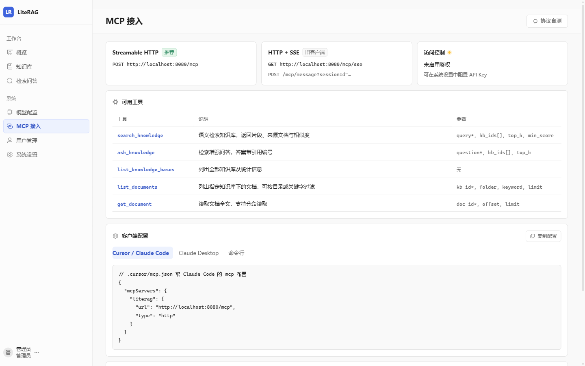
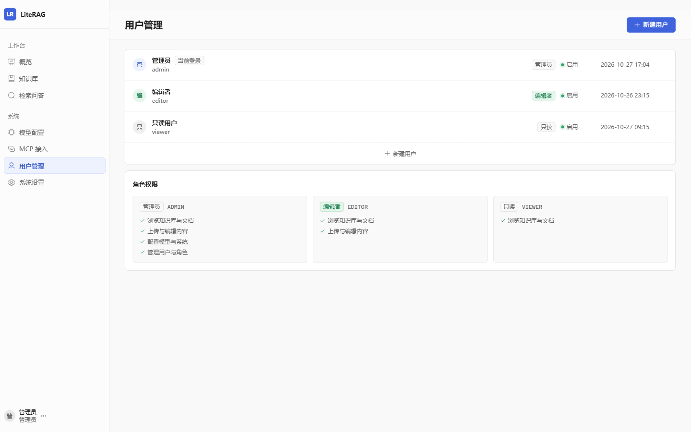
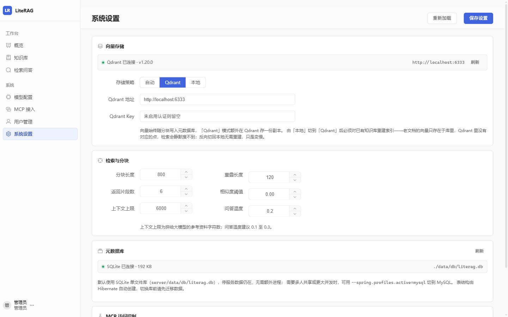
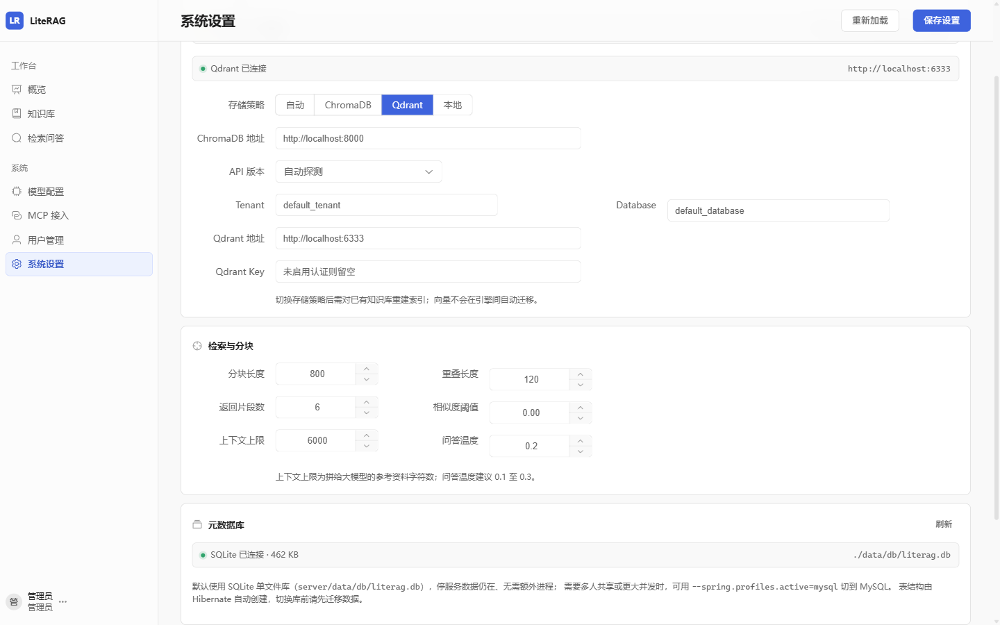

# LiteRAG

本地部署的轻量级 RAG 知识库：上传文档 → 自动解析、分块、向量化 → 网页里检索问答，或通过 **MCP** 把知识库接进 Cursor / Claude。

Vue 3 + Spring Boot 3 + Qdrant，`java -jar` 一个进程同时提供 UI、REST API 与 MCP 端点，运行期不依赖 Python。



## 功能一览

| 能力 | 说明 |
| --- | --- |
| 文档接入 | docx / pdf / xlsx / xls / pptx / md / txt / csv / html，多文件上传、异步解析入库；也可在线新建与编辑 Wiki 页面 |
| 分块策略 | **上传时按文件选择**：智能推荐（按类型路由）/ 标题结构 / 表格优先 / 固定长度，策略随文档保存，重建索引沿用 |
| 目录归档 | 知识库内多级目录（≤6 层），父目录自动含子目录；删除目录只删结构，文档上移 |
| 原样预览 | 抽屉内看原始版面：PDF 浏览器原生渲染，docx 还原段落与表格，xlsx 带行列标与工作表切换，pptx 按幻灯片坐标渲染 |
| 检索问答 | 向量召回 + 大模型总结，答案带 `[1][2]` 引用；未配置对话模型时降级为返回原文片段 |
| Embedding | OpenAI 兼容接口（硅基流动 / 通义 / OpenAI / 智谱）、Ollama 本地模型、内置离线哈希模型，可随时切换与测活 |
| 向量存储 | Qdrant（唯一外部引擎，`tools/qdrant/` 已放好 Windows / Linux x64 可执行文件）+ 进程内余弦检索兜底，设置页可切换 |
| 权限 | 账号密码登录，三档角色 + 知识库级可见范围，文档、目录、检索结果、统计全链路过滤 |
| MCP | 原生 JSON-RPC 2.0，同时支持 Streamable HTTP 与 HTTP+SSE，暴露 5 个工具 + 4 类资源 |

## 界面

**知识库与文档**：左侧目录树、右侧文档列表，状态、片段数、更新时间一目了然。



上传时逐份选择分块规则，智能推荐会按文件类型自动路由：

<p align="center"></p>

**检索问答**：先看片段相似度，再决定是否交给大模型总结；命中自带来源文档与出处。



**MCP 接入**：端点、可用工具、客户端配置一页齐活，复制即可贴进 Cursor / Claude Desktop。



| 用户与角色 | 系统设置 |
| --- | --- |
|  |  |

## 技术栈

| 层 | 选型 |
| --- | --- |
| 后端 | Spring Boot 3.2.5 / Java 17 / Spring Data JPA / SQLite（默认，单文件免安装）/ MySQL（可选） |
| 解析 | Apache POI（docx、xlsx、pptx）、PDFBox（pdf） |
| 向量库 | Qdrant 1.20.0（`tools/qdrant/` 下的 Windows / Linux x64 二进制，或 Docker）；未启动时默认策略会直接报错，可在设置里切换为进程内本地检索 |
| 前端 | Vue 3 + Vite 5 + Element Plus + Pinia + Vue Router（hash 路由） |
| 预览 | 浏览器原生 PDF、docx-preview、SheetJS、POI 自绘 HTML |
| 协议 | MCP 2025-06-18（Streamable HTTP）/ 2024-11-05（HTTP+SSE） |

## 快速开始

环境要求：JDK 17+、Maven 3.8+、Node.js 18+；数据库无需安装（内置 SQLite 单文件库），向量库用 Qdrant 单文件可执行程序，已放在 `tools/qdrant/` 下（Linux / macOS 缺失时会自动下载）。

**方式一：一键启动**

```bash
scripts\start.bat        # Windows
bash scripts/start.sh    # macOS / Linux
```

脚本会先拉起 Qdrant（`tools/qdrant/` 下按平台选可执行文件，已在运行则跳过）→ 构建前端 → 打包后端 → 启动服务，然后访问 <http://127.0.0.1:8080>。

**方式二：开发模式**

```bash
bash scripts/qdrant.sh start        # 启动本地 Qdrant（端口 6333）
docker compose up -d qdrant         # 或改用 Docker 版
cd server && mvn spring-boot:run   # 后端 8080
cd web && npm install && npm run dev   # 前端 5173，/api 与 /mcp 已代理到 8080
```

**方式三：只跑 jar**

```bash
cd server && mvn -DskipTests package
java -jar target/literag-server-1.0.0.jar --server.port=8080
```

打包时会把 `web/dist` 复制进 jar；不存在则只提供 API 与 MCP。

**演示账号**（首次启动自动创建，登录页可点击填充）

| 账号 | 密码 | 角色 | 可见范围 |
| --- | --- | --- | --- |
| `admin` | `admin123` | 管理员 | 全部页面，含模型配置、用户管理、系统设置 |
| `editor` | `editor123` | 编辑者 | 除模型配置、用户管理、系统设置 |
| `viewer` | `viewer123` | 只读 | 概览、知识库、检索问答、MCP 接入，无写操作 |

## 关键配置

### 数据库

默认使用 **SQLite** 单文件库，落在 `server/data/db/literag.db`，免安装、无额外进程，**停服务数据仍在**（WAL 模式下同目录还有 `-wal` / `-shm` 两个附属文件，属正常）。表结构由 Hibernate 首次启动自动创建。

| 场景 | 做法 |
| --- | --- |
| 默认 SQLite | 无需配置。已开 WAL + `busy_timeout=10000` + `transaction_mode=IMMEDIATE`，实测 8 个文件并发上传无冲突 |
| 改用 MySQL | `java -jar literag-server.jar --spring.profiles.active=mysql`，或用环境变量 `SPRING_DATASOURCE_USERNAME` / `SPRING_DATASOURCE_PASSWORD` / `SPRING_DATASOURCE_URL` 覆盖连接串 |
| 换回 H2 | 覆盖 `spring.datasource.url`、`driver-class-name`、`spring.jpa.database-platform` 三项即可 |

MySQL 需先建库，字符集必须是 utf8mb4（否则部分中文与 emoji 会截断）：

```sql
CREATE DATABASE literag DEFAULT CHARACTER SET utf8mb4 COLLATE utf8mb4_unicode_ci;
```

从旧版 H2 库迁移现有数据（覆盖式写入，可重复执行；先以 SQLite 配置启动一次服务，让 Hibernate 建好表）：

```bash
scripts/migrate-db.bat           # 预检：只打印两端表结构与行数，不写数据
scripts/migrate-db.bat --force   # 实际迁移，完成后自动校准自增序列
```



### Embedding 模型

| 供应商 | provider | baseUrl | modelName | 维度 |
| --- | --- | --- | --- | --- |
| 硅基流动 | `openai` | `https://api.siliconflow.cn/v1` | `BAAI/bge-m3` | 1024 |
| 通义千问 | `openai` | `https://dashscope.aliyuncs.com/compatible-mode/v1` | `text-embedding-v3` | 1024 |
| OpenAI | `openai` | `https://api.openai.com/v1` | `text-embedding-3-small` | 1536 |
| Ollama | `ollama` | `http://localhost:11434` | `bge-m3` | 1024 |
| 离线演示 | `local` | 留空 | `local-hash-256` | 256 |

任何 OpenAI 兼容服务都填 `openai`；`local` 为零依赖的哈希向量，仅用于跑通流程，正式使用请换成真实模型。对话模型（CHAT 类型）可选，不配也能检索。

> 新建知识库时不再单独选模型与分块参数：**向量模型取「模型配置」中的默认 Embedding 模型，分块长度与重叠取「系统设置 · 检索与分块」的默认值**。更换 Embedding 模型后必须重建索引，否则维度不一致。

### 向量库

向量引擎只保留 **Qdrant**（外部服务）与 **本地**（进程内余弦扫描，零依赖兜底）两种。

| 平台 | 可执行文件 | 说明 |
| --- | --- | --- |
| Windows x64 | `tools/qdrant/qdrant.exe` | 项目目录已放好，约 87 MB |
| Linux x64 | `tools/qdrant/linux-x64/qdrant` | 项目目录已放好（Qdrant 1.20.0），缺失时脚本自动下载 |
| macOS arm64 | `tools/qdrant/darwin-arm64/qdrant` | 缺失时由脚本自动下载 |

> 两个二进制各约 90 MB，`tools/` 已在 `.gitignore` 中不入库；换机器克隆后 Windows 需手动补 `qdrant.exe`，Linux / macOS 由 `start` 或 `qdrant.sh` 首次运行时自动下载。

`scripts/qdrant.sh` 统一管理（数据目录固定为 `tools/qdrant/storage`）：

```bash
bash scripts/qdrant.sh start     # 未运行则后台启动，最多等 30s 健康检查
bash scripts/qdrant.sh status    # 打印地址与版本
bash scripts/qdrant.sh stop      # 先按 pidfile，再按端口兜底结束进程
bash scripts/qdrant.sh restart
```

也可以直接用 Docker：`docker compose up -d qdrant`（数据落 `data/qdrant`，与本地二进制互不影响）。

- `literag.vector.provider` 支持 `qdrant`（默认，连不上直接报错）/ `local`（进程内余弦扫描）/ `auto`（探测 Qdrant，不可用则回退本地），也可在「系统设置」里切换。向量在任何模式下都随分块写进元数据库，Qdrant 模式只是额外存一份副本，因此 **`local` → `qdrant` 必须对已有知识库重建索引**（老文档在 Qdrant 里没有点，会静默搜不到），**`qdrant` → `local` 无需重建**，只是检索变慢。
- REST 端口 `6333`，`http://localhost:6333/dashboard` 有自带管理界面。liteRAG 用内置 REST 客户端访问，无需 SDK；系统设置与概览页会显示 `v1.20.0` 这类实际版本号。
- collection 在首次写入时按实际向量维度创建，相似度统一使用 Cosine，score 语义（0~1，越大越相关）与本地引擎一致。
- 旧版本配置过 ChromaDB 的，启动时 `vectorProvider=chroma` 会自动按 `qdrant` 处理，`chroma*` 遗留设置项被忽略。

### 分块

| 策略 | 行为 |
| --- | --- |
| 智能推荐（默认） | md / pptx / Wiki → 标题结构；xlsx / xls → 表格优先（无表格结构回退固定长度）；其余 → 固定长度 |
| 标题结构 | 按 Markdown 标题层级切分，每块首行带章节路径（如 `部署指南 > Docker 方式`），命中自带出处 |
| 表格优先 | 识别解析出的工作表小节，按「表头 + 行组」打包，每块重复表头，单独一块即可读 |
| 固定长度 | 段落 → 句子 → 硬切三级回退 + 相邻块重叠（默认 800 字 / 120 字重叠，在系统设置调整） |

### 权限

| 权限点 | 管理员 | 编辑者 | 只读 | 覆盖操作 |
| --- | :---: | :---: | :---: | --- |
| `content:read` | ✓ | ✓ | ✓ | 浏览、预览、下载、检索、统计 |
| `content:write` | ✓ | ✓ | | 建库、上传、新建 Wiki、编辑、移动、删除、重建索引 |
| `config:manage` | ✓ | | | 模型配置、向量库参数、MCP 密钥、系统设置 |
| `user:manage` | ✓ | | | 用户新建、改角色、停用、重置密码、删除 |

知识库还可设「全员可见」或「指定角色 / 用户可见」，受限库的文档、目录、分块、原文件预览、检索命中、统计全部继承该范围，管理员始终可见。密码使用 PBKDF2-HMAC-SHA256（12 万次迭代 + 随机盐），连续 5 次错误锁定 60 秒；令牌存库并下发 HttpOnly Cookie，登出、改密、停用或改角色后立即失效。

## MCP 接入

| 传输 | 地址 |
| --- | --- |
| Streamable HTTP（推荐） | `POST http://<host>:8080/mcp` |
| HTTP + SSE（旧客户端） | `GET http://<host>:8080/mcp/sse` |

```json
{
  "mcpServers": {
    "literag": {
      "url": "http://127.0.0.1:8080/mcp",
      "type": "http"
    }
  }
}
```

| 工具 | 参数 | 说明 |
| --- | --- | --- |
| `search_knowledge` | `query*`, `kb_ids[]`, `top_k`, `min_score` | 语义检索，返回片段、来源文档与相似度 |
| `ask_knowledge` | `question*`, `kb_ids[]`, `top_k` | 检索增强问答，答案带引用编号 |
| `list_knowledge_bases` | 无 | 列出知识库及统计 |
| `list_documents` | `kb_id*`, `keyword`, `limit` | 列出知识库下文档 |
| `get_document` | `doc_id*`, `offset`, `limit` | 读取文档全文，支持分段 |

资源：`literag://knowledge-bases`、`literag://kb/{kbId}`、`literag://kb/{kbId}/documents`、`literag://doc/{docId}`。
`/mcp` 不走登录态，在「系统设置」配置 MCP API Key 后客户端需带 `X-API-Key`（SSE 可用 `?apiKey=`）。Claude Desktop 可用 `npx -y mcp-remote http://127.0.0.1:8080/mcp` 转接。

## REST API

统一响应 `{ "code": 0, "message": "ok", "data": ... }`；除 `/api/auth/login` 外都需要登录（未登录 401，权限不足 403），规则集中在 `security/AuthInterceptor`。主要接口：

| 方法 | 路径 | 说明 |
| --- | --- | --- |
| POST | `/api/auth/login` `/logout`、GET `/api/auth/me` | 登录、登出、当前用户与权限点 |
| GET/POST | `/api/kb` | 知识库列表（仅返回可见的）/ 新建 |
| GET/PUT/DELETE | `/api/kb/{id}`、POST `/api/kb/{id}/reindex` | 详情、更新（含可见范围）、删除、重建索引 |
| GET/POST | `/api/kb/{kbId}/documents`、`/documents/upload` | 文档分页 / 多文件上传（multipart，可选 `strategy`、`folderId`） |
| GET/POST | `/api/kb/{kbId}/folders`、`/api/kb/{kbId}/wiki` | 目录树 / 新建 Wiki 页面 |
| GET/PUT/DELETE | `/api/documents/{id}`、`/chunks`、`/raw`、`/slides` | 文档详情、编辑、分块列表、原文件与版式预览 |
| POST | `/api/search`、`/api/chat/ask` | 向量检索、RAG 问答 |
| GET/POST/PUT/DELETE | `/api/models`、`/api/settings`、`/api/users` | 模型、设置、用户管理 |

## 目录结构

```
liteRAG/
├─ server/          # Spring Boot 后端（controller / service / parser / vector / ai / mcp）
├─ web/             # Vue 3 前端（views：概览、知识库、检索问答、模型、MCP、用户、设置）
├─ scripts/         # 启停脚本（start / qdrant / 数据库迁移）、演示文档生成
├─ tools/qdrant/    # Qdrant 可执行文件（Windows / Linux x64）与向量数据 storage/（不入库）
├─ docs/screenshots/# README 截图
├─ data/            # 运行期数据：SQLite 库、上传文件、日志（不入库）
└─ docker-compose.yml
```

运行期数据落盘：元数据 `server/data/db/literag.db`（SQLite 单文件）、原始文件 `server/data/uploads/{kbId}/...`、Qdrant 数据在 `tools/qdrant/storage/`（Docker 版在 `data/qdrant/`）；向量始终存在 `doc_chunk.embedding` 字段，Qdrant 模式为额外副本。

## 常见问题

**检索结果为空或相似度很低？** 确认文档状态是「已就绪」、collection 有数据、模型一致；离线哈希模型语义能力弱，建议换 bge-m3。

**上传后一直处理中？** 看 `data/server.log`，常见原因是文件加密或扫描件 PDF 没有文本层（本系统不含 OCR）。

**向量库连不上？** `qdrant` 策略下检索会直接报错（默认），`auto` 会静默回退本地、`local` 不受影响。先 `bash scripts/qdrant.sh start`（Windows 可直接跑 `tools\qdrant\qdrant.exe`），修好后在系统设置切回。注意掉线期间若走过本地回退入库，那批文档在 Qdrant 里没有索引点，需要重建索引才能被检索到。

**端口被占用？** `java -jar ... --server.port=9090`，同时改 `web/vite.config.js` 的代理目标。

**数据存在哪？换数据库会丢吗？** 元数据在 `server/data/db/literag.db`，原始文件在 `server/data/uploads/`，备份只需整个 `server/data/` 目录。切库不会自动搬数据（Hibernate 只负责建表）：从旧版 H2 切到 SQLite 用 `scripts/migrate-db.bat`，已有 SQLite 数据要转 MySQL 则需自行导出导入。

## License

[Apache-2.0](LICENSE)
